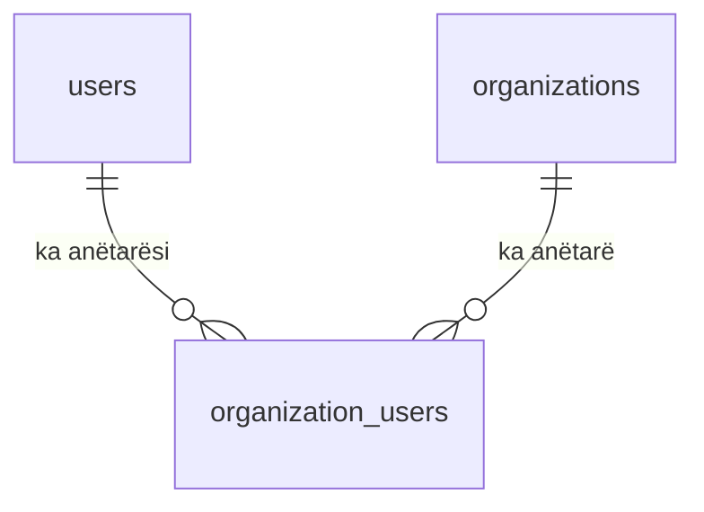

# Karta 11 — Organizatat dhe anëtarësitë

**Statusi** — Analizë dhe plan implementimi. Kontrata e API-së dhe kufijtë e roleve më poshtë janë propozimi i modulit.

[Analiza e sistemit](../analiza-e-sistemit.md) · [Arkitektura e backend-it](../arkitektura-backend.md) · [Karta 10 — Autorizimi](02-authorization-roles-permissions-audit.md)

## Qëllimi

Organizata ka profil, status verifikimi dhe një listë anëtarësh. Anëtarësia përcakton aksesin në organizatën konkrete. Një përdorues mund të jetë `owner` në organizatën A dhe `member` në organizatën B. Rolet e platformës vazhdojnë të ruhen te `role_user`. Backend-i lexon anëtarësinë aktuale në çdo kërkesë të mbrojtur, kështu që heqja e aksesit hyn në fuqi edhe kur përdoruesi vazhdon të përdorë të njëjtën JWT.

Kjo kartë mbulon krijimin dhe menaxhimin e profilit, shqyrtimin e organizatës dhe menaxhimin e anëtarësive. Ftesat me email, transferimi i pronësisë, fshirja e organizatës dhe veprimet mbi mundësitë ose aplikimet trajtohen si punë pasuese.

## Aksesi

| Aktori | Çfarë mund të bëjë |
| --- | --- |
| Vizitor | Vazhdon të shfletojë katalogun publik. Kjo kartë nuk shton endpoint publik për organizatat. |
| Përdorues aktiv me email të verifikuar | Krijon organizatë dhe bëhet pronari i saj. |
| `member` | Lexon profilin privat të organizatës së vet. |
| `owner` | Lexon dhe përditëson profilin, sheh listën e anëtarëve dhe shton ose heq anëtarë të zakonshëm në organizatën e vet. |
| Përdorues me `organizations.approve` | Liston organizatat për shqyrtim dhe vendos aprovimin ose refuzimin. Seeder-i i Kartës 10 ia jep këtë leje `super_admin`. |

Rolet globale nuk japin automatikisht akses në profilin privat apo listën e anëtarëve. Rrjedha administrative e shqyrtimit ka endpoint-et dhe përgjigjet e veta. Për organizatën B, një anëtar vetëm i organizatës A merr `403` kur rekordi ekziston. Të gjitha rrugët e modulit kërkojnë JWT të vlefshme, llogari aktive dhe email të verifikuar.

## Skema

| Tabela | Kolona | Tipi dhe kufizimet |
| --- | --- | --- |
| `organizations` | `id` | BIGINT UNSIGNED, PK |
| | `name` | VARCHAR(255), e detyrueshme |
| | `description` | TEXT, nullable |
| | `status` | VARCHAR me vlerat `pending`, `approved`, `rejected`. Default `pending`. |
| | `created_at`, `updated_at` | Timestamps Laravel |
| `organization_users` | `organization_id` | BIGINT UNSIGNED, FK drejt `organizations.id`, cascade në fshirje |
| | `user_id` | BIGINT UNSIGNED, FK drejt `users.id`, restrict në fshirje |
| | `role` | VARCHAR me vlerat `owner` dhe `member` |
| | `created_at`, `updated_at` | Timestamps Laravel |

Çifti `(organization_id, user_id)` është çelës primar i përbërë. Indeksi `(user_id, organization_id)` mbështet listën e organizatave të përdoruesit. Indeksi `(status, id)` mbështet listën e shqyrtimit. `restrict` te lidhja me përdoruesin parandalon fshirjen fizike të një llogarie që ende ka anëtarësi. Kur të shtohet fshirja e llogarive, ajo duhet të trajtojë anëtarësitë dhe pronësinë.

Skema lejon organizata pa anëtarësi, siç parashikon analiza e sistemit. Rrjedha e krijimit nga API-ja krijon gjithmonë organizatën dhe anëtarësinë e krijuesit si `owner` brenda një transaksioni. Menaxhimi i anëtarësive përmes API-së ndryshon vetëm anëtarët me rol `member`, prandaj nuk heq pronarin.

`opportunities.organization_id` shtohet kur të lidhet rrjedha e menaxhimit të mundësive. Migrimi i parë e lejon `NULL`. Pasi çdo rekord ekzistues të lidhet me një organizatë të identifikuar, migrimi pasues e bën kolonën të detyrueshme. Katalogu publik vazhdon të punojë gjatë kalimit.

## Rrjedhat dhe kontrata e propozuar

| Metoda dhe rruga nën `/api/v1` | Aksesi | Hyrja dhe rezultati |
| --- | --- | --- |
| `POST /organizations` | Përdorues i verifikuar | `name`, `description` opsionale. Kthen `201` me organizatën `pending`. |
| `GET /organizations` | Përdorues i verifikuar | Listë e paginuar e organizatave ku ka anëtarësi. |
| `GET /organizations/{organization}` | `owner`, `member` | Kthen profilin dhe statusin. |
| `PATCH /organizations/{organization}` | `owner` | Përditëson `name` ose `description`. Kthen `200` me profilin. |
| `GET /organizations/{organization}/members` | `owner` | Listë e paginuar me ID-në, emrin dhe rolin e secilit anëtar. |
| `POST /organizations/{organization}/members` | `owner` | `user_id` e një llogarie ekzistuese, aktive dhe të verifikuar. Backend-i cakton `member`. Kthen `201`. |
| `DELETE /organizations/{organization}/members/{user}` | `owner` | Heq anëtarësinë `member` nga ajo organizatë. Kthen `204`. |
| `GET /admin/organizations` | `organizations.approve` | Listë e paginuar për shqyrtim, me filtër opsional `status`. |
| `PATCH /admin/organizations/{organization}/status` | `organizations.approve` | `status: approved` ose `status: rejected`. Kthen `204`. |

Emri pastrohet nga hapësirat në skaje dhe validimi refuzon emrin bosh. Endpoint-i i krijimit merr vetëm fushat e profilit. Statusi fillestar dhe anëtarësia e pronarit caktohen nga backend-i. Për listën private, Repository filtron sipas anëtarësisë përpara paginimit. Listat përdorin renditje të qëndrueshme sipas ID-së. Përgjigjet me të dhëna ndjekin formatin `message` dhe `result` të API-së.

`pending → approved` dhe `pending → rejected` janë vendimet e shqyrtimit. Ndryshimi i profilit pas një refuzimi ose aprovimi e kthen organizatën në `pending` për rishqyrtim. Një payload që përsërit të njëjtat vlera nuk e ndryshon statusin. Përsëritja e të njëjtit vendim kthen `204` pa audit të ri. Kalimet e tjera të statusit dhe një anëtarësi e dyfishtë kthejnë `409`. `401` përdoret për autentikim të pavlefshëm, `403` për mungesë aksesi, `404` për rekord ose anëtarësi që mungon dhe `422` për hyrje të pavlefshme.

## Transaksionet dhe auditimi

- **Krijimi.** Service hap transaksionin, Repository krijon organizatën dhe lidh krijuesin si `owner`. Nëse lidhja dështon, organizata kthehet prapa.
- **Anëtarësitë.** Service kontrollon pronësinë dhe gjendjen e llogarisë së synuar. Repository kërkon anëtarësinë sipas çiftit të ID-ve. Çelësi unik mbron edhe nga dy tentativa paralele për të shtuar të njëjtin anëtar.
- **Shqyrtimi dhe ndryshimi i profilit.** Service kyç rreshtin e organizatës përmes Repository dhe lexon statusin aktual para se të zbatojë kalimin. Kjo serializon shqyrtimin dhe ndryshimin e profilit.
- **Auditimi.** Përdor `audit_logs` me `subject_type = organization` dhe ID-në e organizatës. Regjistro ndryshimet reale të statusit, shtimin dhe heqjen e anëtarëve. Për statusin ruaj vlerën para dhe pas. Për anëtarësinë ruaj `user_id` dhe rolin përkatës. Shkrimi i auditit dhe ndryshimi kryhen në të njëjtin transaksion.

## Implementimi sipas shtresave

1. **Migration dhe Model.** Krijo `organizations` dhe pastaj `organization_users`. Shto `Organization::users()` dhe `User::organizations()` me `belongsToMany`, `withPivot('role')` dhe `withTimestamps()`. Përdor një reprezentim të përbashkët për vlerat e statusit dhe roleve të anëtarësisë.
2. **Repository dhe Provider.** Krijo `IOrganizationRepository` dhe `Eloquent/OrganizationRepository`. Vendos aty query-t për anëtarësitë, listat e filtruara, kyçjen, shkrimet dhe lidhjet. Regjistro binding-un në `RepositoryServiceProvider`. Rishiko kontratën e auditimit të Kartës 10 dhe nxirr një operacion të përbashkët që mbështet edhe subjektin `organization`.
3. **Service.** `OrganizationService` koordinon krijimin, tranzicionet e statusit, ndryshimin e anëtarësive dhe auditimin. Ai përcakton transaksionet dhe ia delegon Repository-t leximet e shkrimet.
4. **Policy dhe HTTP.** `OrganizationPolicy` kontrollon anëtarësinë e rekordit dhe lejen globale të shqyrtimit. FormRequest validon hyrjen, Controller autorizon përmes Policy dhe thërret Service-in, ndërsa Resource dhe Collection formatizojnë përgjigjet. Route-t ripërdorin autentikimin dhe kontrollin e llogarisë nga Karta 10.
5. **Verifikimi.** Testo fillimisht krijimin dhe leximin e organizatës nga API-ja. Pastaj verifiko veprimet mbi anëtarësitë, shqyrtimin dhe auditimin.

## Kriteret e pranimit

- [ ] Krijimi ruan organizatën `pending` dhe anëtarësinë `owner` së bashku. Dështimi i lidhjes nuk lë organizatë të pjesshme.
- [ ] I njëjti përdorues mund të ketë role të ndryshme në dy organizata. Çifti i njëjtë ruhet vetëm një herë, edhe kur kërkesat vijnë paralelisht.
- [ ] Lista private përmban vetëm organizatat e përdoruesit. Anëtari i A-së merr `403` kur kërkon profilin privat të B-së.
- [ ] `member` nuk mund të ndryshojë profilin ose anëtarësitë. `owner` mund të shtojë dhe të heqë `member` vetëm në organizatën e vet.
- [ ] Pas heqjes së anëtarësisë, e njëjta JWT nuk jep më akses në atë organizatë.
- [ ] Llogaria e pezulluar refuzohet nga middleware. Përdoruesi pa email të verifikuar merr `403`.
- [ ] Vetëm llogaria me `organizations.approve` mund të shqyrtojë organizatat. Ndryshimi pas aprovimit kthen profilin në `pending`.
- [ ] Auditimi ruan aktorin dhe ndryshimin real. Kur auditimi dështon, transaksioni i ndryshimit kthehet prapa.
